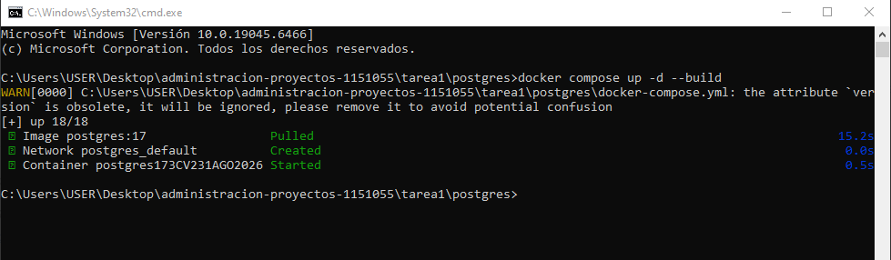
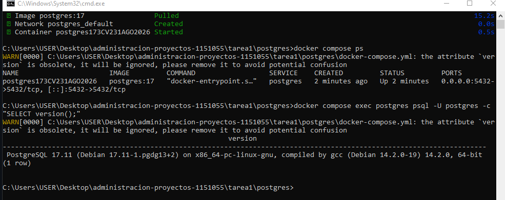
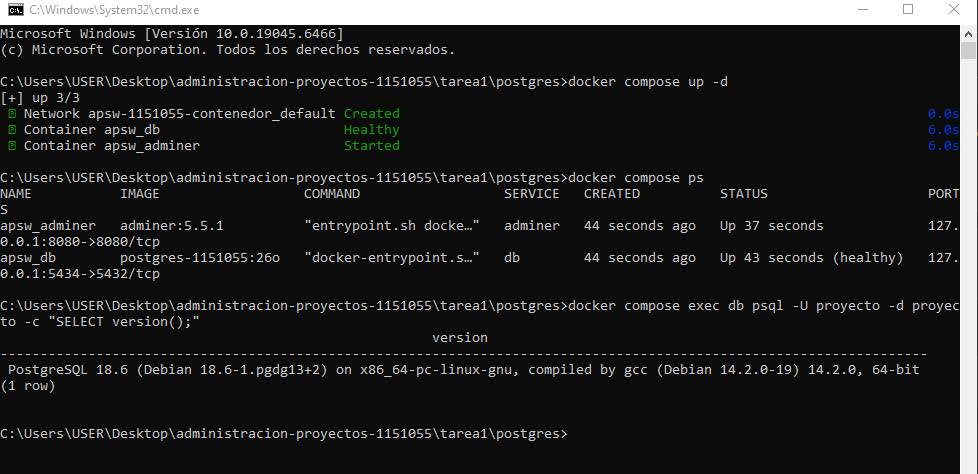
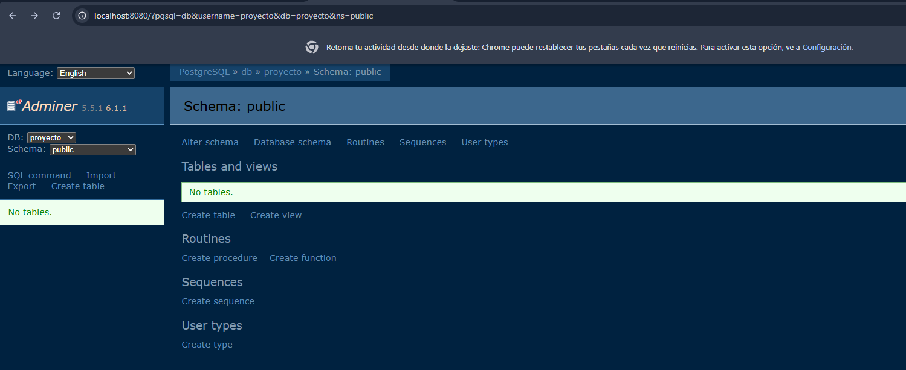
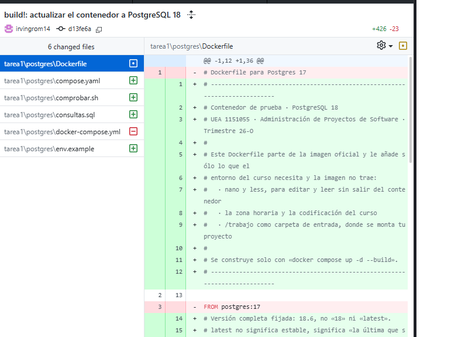
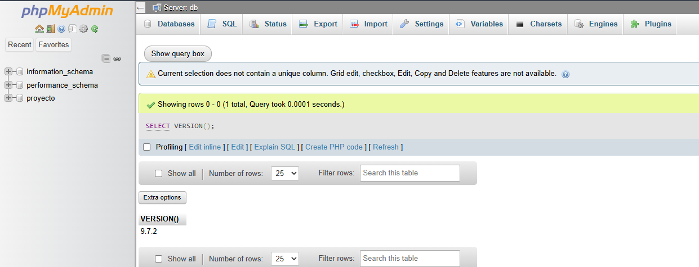
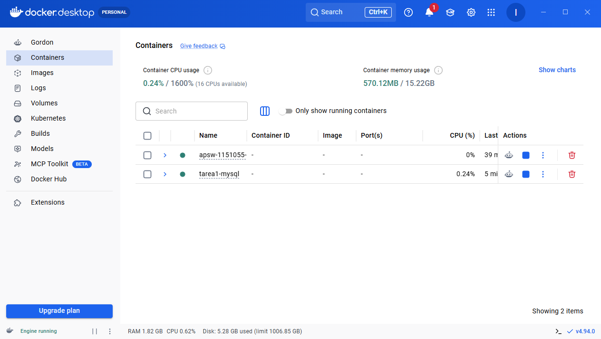
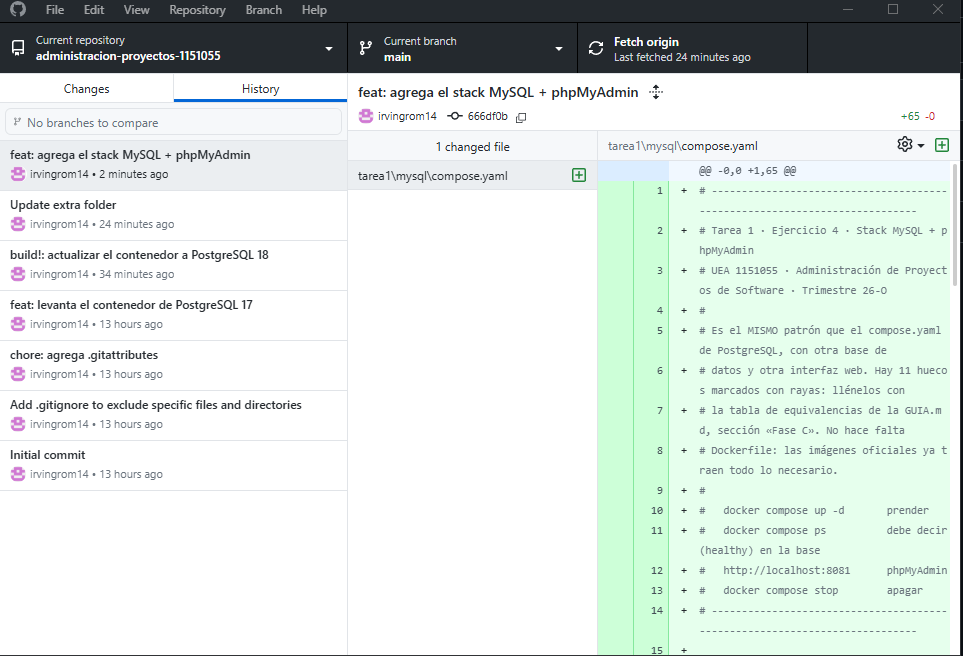

# TAREA 1 - Administración de Proyectos de Software

**1.¿Qué es un proyecto de software? Proyecto frente a operación continua; proyecto, producto y
proceso; alcance, tiempo, costo y calidad.**

Consiste en todo un proceso desde diseñar, desarrollar e implementar un tipo de solución con el fin de resolver un determinado problema o en otro caso mejorar dicho proceso, a diferencia de una operación contínua este es temporal comenzando persiguiendo un objetivo finalizando al hacer la entrega del producto

Un proceso es la forma en que se va organizar una operación este tiene que estar bien estructurado para garatinzar la consistencia y la calidad de las operaciones, como mencionaba antes, el proyecto tiene un tiempo definido con fines claros y entregables específicos, por último el producto es el resultado de la conclusión de este

En el alcance se presentan los entregables y tareas que deberán cumplirse para lograr los objetivos del proyecto este puede cambiar durante la realización del proyecto, el costo es el presupuesto que se tiene para desarrollar el proyecto incluyendo salario de empleados, equipo, herramientas, esapcios y cual otro recurso que sea necesario, el tiempo es lo que tardará un proyecto en completarse este podrá aumentar o disminuir dependiendo el alcance que se le de al proyecto, finalmente la calidad será el grado en que el resultado del proyecto cumple con los requisitos que se acordaron en el proyecto

* Arcus. (2026, 30 agosto). Guía de tipos de proyectos de software y cómo desarrollarlos. Arcus Blog. https://www.arcusway.com/post/guia-de-tipos-de-proyectos-de-software-y-como-desarrollarlos

* Guía de gestión de procesos vs gestión de proyectos. (s. f.). https://www.larksuite.com/es_mx/blog/process-management-vs-project-management

* Staff, C. (2026, 11 junio). ¿Qué es el triángulo de oro de gestión de proyectos? Coursera. https://www.coursera.org/mx/articles/project-management-triangle

---

**2.¿Cómo se administra? Qué son la Guía del PMBOK y Scrum, y en qué se distinguen los modelos
predictivo, iterativo y ágil. Cuál elegiría para un proyecto como el del curso.**

Para administrar un proyecto de software se requiere un enfoque de planificación, organización y supervisión de tareas y recursos que ayudará a lograr los objetivos dentro del tiempo límite que se le asigna a un proyecto.

La guía del PMBOK contiene una colección completa de fundamentos para la dirección de proyectos donde se encuentran consejos de mejores prácticas, terminología y directirces que existen en el estándar de la gestión de proyectos. Mientras que SCRUM es una de las metodologías más populares que proporcionan ayuda para la elaboración de proyectos complejos diviendo los trabajos en ciclos iterativos más pequeños.

En los modelos predictivos se asume que los requisitos son claros desde un inicio, las fases del proyecto van en secuencia lo que no permite avanzar a una fase posterior sin haber terminado las anteriores, por otro lado en el modo iterativo se construye mediante ciclos repetitivos con el fin de pulir detalles haciendo que en cada uno se mejore la calidad de este, finalmente en el modelo ágil como podría ser SCRUM combina un poco ambos modelos enfocandose más en la velocidad de respuesta y la maximización del valor final, dado esto me inclinaría más por este último modelo mencionado considerando sus beneficios y su uso en el mercado actual

* Jaimovich, D. (2024, 21 octubre). Las 5 fases de la gestión de proyectos. Administracion de Proyectos. https://blog.invgate.com/es/fases-de-la-gestion-de-proyectos

* Gurnov, A., & Wrike. (2026, 30 abril). ¿Qué es PMBOK en gestión de proyectos? Conoce la metodología PMBOK. Wrike. https://www.wrike.com/es/project-management-guide/faq/que-es-pmbok-en-gestion-de-proyectos/

---

**3.¿Con qué herramientas? Para qué sirven el control de versiones, los tableros de trabajo, los
contenedores y la integración continua. Y las del curso: Docker frente a una máquina virtual,
Dockerfile frente a compose.yaml, el volumen, y los comandos up -d, exec, stop, down, ps y logs.**

El control de versiones nos ayuda a tener un seguimiento de cada cambio que se haya realizado al código, ayuda principalmente para tener todo el historial y poder acceder a él en cualquier momento. En los tableros de trabajo podemos estructurar todos los procesos necesarios de inicio a fin con el fin de organizar las estapas a modo de llevar el conrol específico de cada tema. Los contenedores nos permiten empaquetar y ailas las aplicaiones con todo el entorno que requieran para su ejecución, así hace más fácil su portabilidad gracias a la ligereza de este.

A diferencia de una máquina virtual, los contenedores comparten el kernel del sistema operativo haciendolo más ligero y rápido, en este se crean imágenes personalizadas, definiendo el so base, las dependias a instalar, variables de entorno y comandos para compilar la app, mientras que el compose.yaml funciona como orquestación para correr aplicaciones multi-contenedor, aquí se define la relación, volúmen y red de todos los servicios en ese solo archivo. Comandos como:

up -d: Crea, enciende y conecta los servicios definidos, el -d sirve para liberar la consola mientras se ejecuta en segundo plano

exec: Sirve para ejecuar un comando dentro del contenedor que ya está funcionando, uno muy común es docker compose exec < servicio > bash  para abrir terminal dentro del cont.

stop: detiene los contendores sin eliminarlos, los datos se detienen emperando ser reactivado con un start

down: Aquí si detiene y borra por completo el contenedor, se puede proteger los volúmenes que se agreguen con la bandera -v

ps: Nos muestra el estao actual en el que se encuentran los contenedores asociados al proyecto, junto con sus puertos

logs: Muestra la salida estandar y de error de los contenedores sirven para depurar fallos

* GitLab. (s. f.). ¿Qué es el control de versiones? GitLab. https://about.gitlab.com/es/topics/version-control/

* Explicación sobre los contenedores: concepto e importancia. (s. f.). https://www.redhat.com/es/topics/containers

---

**4.¿Bajo qué licencia se distribuye el software? Todo programa tiene una licencia que dice qué puede
hacer con él quien lo recibe —usarlo, modificarlo, redistribuirlo, venderlo— y con qué obligaciones.
Usted eligió una al crear su repositorio. Investigue:**

  a)  Los dos grandes tipos. Qué es una licencia permisiva (MIT, BSD, Apache 2.0) y qué es una copyleft (GPL, LGPL, AGPL). Una tabla con lo que permite y lo que exige cada una.

Las licencias permitivas se caracterizan por ser de software libre con requisios mínimos acerca de cómo redistribuir dicho software ofreciendo la máxima libertad a los usuarios, mientras que las licencias de tipo copyleft se enfocan en crear un programa que no tenga restricciones, requieriendo que odas las versiones que se le realicen también sean gratuitas utilizando las leyes de los derechos de autor para garantizar esta libertad para siempre

| Acción | Licencias Permisivas| Licencias Copyleft  |
| :--- | :--- | :--- |
| Copiar y usar el código | Sí, sin restricciones. | Sí, sin restricciones. |
| Modificar el código fuente | Sí, puedes cambiar lo que quieras. | Sí, puedes cambiar lo que quieras. |
| Uso comercial | Sí, puedes usarlo en productos que generen dinero. | Sí, el uso comercial está permitido (vender soporte, binarios, etc.). |
| Cerrar el código modificado | Sí. Puedes crear un software privado y no mostrar tus cambios a nadie. | No. Si distribuyes el software, tus modificaciones deben ser públicas y abiertas. |
| Integrar en software propietario | Sí. Tu código cerrado puede devorar el código permisivo sin "contagiarse". | No. El código copyleft exige que todo el producto final se vuelva de código abierto (excepto ciertas librerías en LGPL). |
| Ofrecerlo como servicio en la nube | Sí. No tienes que liberar nada. | Depende. Con GPL/LGPL sí puedes; con AGPL estás obligado a liberar el código de tu plataforma. |
| Exigencia principal | Dar crédito. Mantener el aviso de copyright y los nombres de los autores originales. | Mantener la libertad. Compartir el código fuente modificado bajo la misma licencia original. |

  b) Su elección. Por qué su repositorio usa MIT, qué ventajas tiene y qué cambiaría si hubiera elegido GPL.

Ya que permite que el código se integre en cualquier ecosistema además de su flexibilidad y adopción universal ya que se puede utilizar el código en cualquier tipo de proyectos

  c) Un caso real, a elegir, en que la decisión de la empresa dueña de un proyecto llevó a sus usuarios a crear o adoptar una alternativa:
    – MySQL, que pasó a manos de Oracle, y MariaDB.
    – El JDK de Oracle, que empezó a cobrarse para uso comercial, y OpenJDK o Amazon Corretto.
    – CentOS, que Red Hat sustituyó por CentOS Stream, y AlmaLinux o Rocky Linux.
    Cuente qué pasó y cuándo, qué licencia tenía el proyecto, y la clave: por qué esa licencia permitió
    que la alternativa existiera sin pedirle permiso a nadie. 

MySQL pasa a estar en manos de Oracle

En 2009 Oracle anunció la compra de Sun Microsystems lo que implicaba que MySQL sería parte de Oracle, lo cual asustó a los usuarios de código abierto porque pensaron que cambiaría las reglas para forzar a las empresas a pagar por el servicio

Sin embargo Monty Widenius justo antes de renunciar a la compañía decidió tomar el código fuente de MySQL y mediante una bifurcación exacta (fork) lo nombró MariaDB, con el objetivo de mantener viva la base de datos de manera 100% transparente y libre

Contaba con la licencia GPL por lo que a pesar de que Oracle compró la marca de MySQL no podía cambiar el código fuente legal debido a esta licencia por lo que el código ya era propiedad pública haciendo valer su derecho legal a la bifurcación por cualquier usuario

* Tal, L. (2020, 16 julio). Open Source Licenses: Types and Comparison. Snyk. https://snyk.io/articles/open-source-licenses/

* Krohalev, R. (2026, 29 septiembre). Software licenses explained: MIT, BSD, Apache, GPL. Shakuro. https://shakuro.com/blog/software-licenses-explained  

---

## PostgreSQL 17 a 18

| Diferencias | PostgreSQL 17 | PostgreSQL 18 |
| :--- | :--- | :--- |
| Versión | Muestra el mensaje de atributo obsoleto| Aquí ya no muesra ese mensaje ya que el .yaml eliminó ese atributo |
| Levantar el servicio | Se levanta un único contenedor de la base de atos a aprtir de la imágen | aquí se levantan dos contenedores, la bd y el gestor gráfico |
| Estado de salud | Por su configuración más básica solo se ve el tiempo de actividad | Aquí se muestar el mensaje "healthy" lo que indica que el archivo compose.yaml iene configurado un healthcheck |

No se usaba el Dockerfile viejo ya que como se observa a pesar de ejecutar el comando con la instrucción de construccion "docker compose up -d --build" el sistema solo mostró la imagen de postgres 17 Pulled, si en la config del archivo .yml estuviera apuntando a un DOckerfile se hubiera mostrado la construcción de la imagen

El versionado semántico es un sistema  estámdar para numerar las versiones del software basándose en la estructura de los componentes: Principal, Secundaria y Parche.
Pasar de PostgreSQL 17 a 18 representa un incremento a la versión Principal por lo que implica alteraciones mayores a la arquitectura del motor de la bd, por lo que un contenedor de la versión 18 no puede leer volúmen de datos creado por la versión 17

---

## Otro stack: MySQL + phpMyAdmin

| Característica | PostgreSQL + Adminer | MySQL + phpMyAdmin |
| :--- | :--- | :--- |
| Estado de Salud (healthy) | ambas lo tienen | ambas lo tienen |
| Puerto de su interfaz | 127.0.0.1:8000 | via localhost en la web|
| Dockerfile | No se utiliza en l aversion 18 ya que se levantan los contenedores desde las imagenes | No se requiere ya que se especifica que las imagenes ya tienen lo necesario |

La versión LTS (Long Term Support) Son versiones enfocadas exclusivamente en la estabilidad, seguridad y fiabilidad. No reciben nuevas características una vez lanzadas, sino únicamente correcciones de errores

Innovation (Innovación): Son versiones de ciclo de vida corto que se liberan frecuentemente para introducir nuevas funcionalidades, mejoras de rendimiento o cambios arquitectónicos. Están pensadas para entornos de desarrollo o proyectos que requieren acceso temprano a las últimas tecnologías antes de que se consoliden en la siguiente versión LTS

Por qué usar mysql:9.7.2 en lugar de mysql:latest

El escribir la versión directamente asegura que el entorno de desarrollo se idéntico en cualquier PC, por lo que si otro desarrrollador clona el proyecto levvantará el mismo motor y no la última versión de este usuario, así mismo previene rupturas con el tiempo y las nuevas versiones que se lanzen posteriormente

---

## Capturas de pantalla

1. PostgreSQL 17: up -d --build con el aviso de version.

.

2. PostgreSQL 17: ps y SELECT version();.

.

3. PostgreSQL 18: ps con (healthy) y SELECT version();.

.

4. PostgreSQL 18: Adminer con las tablas.

.

5. El diff de la confirmación a la 18, en GitHub.

.

6. phpMyAdmin con SELECT VERSION();.

.

7. Docker Desktop con los dos stacks encendidos.

.

8. El historial de confirmaciones en GitHub.

.